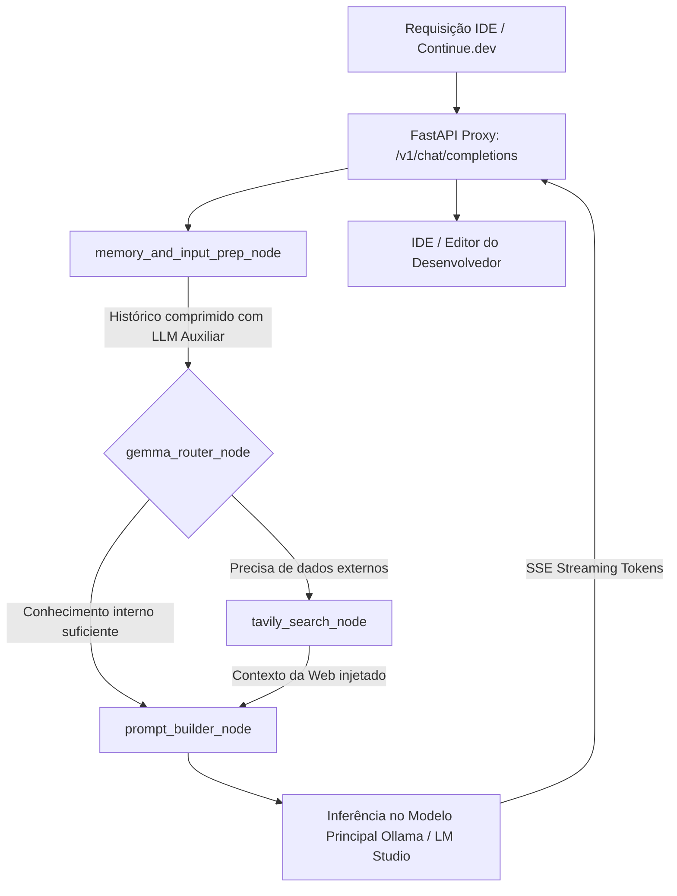

<div align="center">

# ⚡ LangGraph Continue Proxy (Workflow AI Ollama)

**Proxy reverso inteligente com FastAPI, LangGraph e Tavily para orquestração de LLMs locais no [Continue.dev](https://continue.dev/)**

[CI Pipeline](https://www.google.com/search?q=https://github.com/arthurbona123/workflow_ai_ollama/actions/workflows/ci.yml)
[Release](https://www.google.com/search?q=https://github.com/arthurbona123/workflow_ai_ollama/releases)
[](https://www.python.org/)
[](https://opensource.org/licenses/MIT)
[](https://ollama.com/)
[](https://github.com/langchain-ai/langgraph)

</div>

---

## 📌 Sumário

- [Visão Geral](#-visão-geral)
- [Principais Funcionalidades](#-principais-funcionalidades)
- [Arquitetura e Fluxo do Workflow](#-arquitetura-e-fluxo-do-workflow)
- [Modelos Especializados (Modelfiles)](#-modelos-especializados-modelfiles)
- [Modelos Validados e em Testes Contínuos](#-modelos-validados-e-em-testes-contínuos)
- [Tabela de Tecnologias e Dependências](#-tabela-de-tecnologias-e-dependências)
- [Pré-requisitos e Variáveis de Ambiente](#-pré-requisitos-e-variáveis-de-ambiente)
- [Guia Rápido de Instalação e Execução](#-guia-rápido-de-instalação-e-execução)
- [Integração com o Continue.dev](#-integração-com-o-continuedev)
- [Testes e Garantia de Qualidade](#-testes-e-garantia-de-qualidade)
- [Licença](#-licença)

---

## 🚀 Visão Geral

O **LangGraph Continue Proxy** (`workflow_ai_ollama`) é um middleware de proxy reverso construído com **FastAPI** e **LangGraph**, projetado para atuar como ponte entre assistentes de código para IDEs (como o [Continue.dev](https://continue.dev/)) e motores de inferência local ([Ollama](https://ollama.com/) ou [LM Studio](https://lmstudio.ai/)).

Ao usar modelos locais em desenvolvimento de software, dois problemas são recorrentes: o consumo excessivo da janela de contexto durante conversas longas e a falta de acesso a informações e documentações recentes na web. Este projeto resolve esses gargalos implementando:

1. **Compressão Dinâmica de Histórico**: Um modelo leve resume mensagens anteriores em uma memória telegráfica, economizando tokens preciosos de contexto.
2. **Roteamento Autônomo e RAG em Tempo Real**: O orquestrador detecta automaticamente a necessidade de dados externos e consulta a web via [Tavily Search API](https://tavily.com/).
3. **Compatibilidade Total com a API OpenAI**: Exposição do endpoint `/v1/chat/completions` com suporte nativo a respostas em streaming (Server-Sent Events).

---

## ✨ Principais Funcionalidades

- **Compatibilidade OpenAI /v1**: Atua como substituto transparente para ferramentas compatíveis com a especificação da OpenAI.
- **Streaming SSE em Tempo Real**: Repasse contínuo de tokens gerados para resposta imediata na interface da IDE.
- **Memória de Curto Prazo Eficiente**: Utiliza um LLM auxiliar compacto (por exemplo, `liquid/lfm2.5-1.2b`) para destilar e consolidar o histórico antes de cada chamada.
- **Roteamento Inteligente com Decisão Autônoma**: O grafo avalia a intenção da query e aciona busca na web apenas quando estritamente necessário.
- **Modelfiles Pré-configurados para Codificação e Autocomplete**: Configurações dedicadas para modelos como `qwen2.5:1.5b`, ajustadas para backend systems e Fill-In-The-Middle (FIM).
- **Esteira Automatizada de CI/CD**: Verificação contínua com Pytest, cobertura de testes e publicação de releases empacotadas via GitHub Actions.

---

## 🏗️ Arquitetura e Fluxo do Workflow

O fluxo de processamento de cada requisição é governado por uma máquina de estados baseada no **LangGraph** (`AgentState`), estruturada em quatro etapas coordenadas:



### Detalhamento dos Nós do Grafo

1. **`memory_and_input_prep_node`**:
   Lê o histórico de mensagens da sessão e aciona um modelo rápido para sintetizar tópicos essenciais em notas telegráficas, descartando redundâncias e reduzindo o consumo de tokens.
2. **`gemma_router_node`**:
   Classifica se o prompt envolve bibliotecas recentes, erros de compilação com dependências externas ou consultas que demandam dados atualizados da web.
3. **`tavily_search_node`**:
   Executa a busca direcionada na web e formata os snippets mais relevantes para compor o contexto da resposta.
4. **`prompt_builder_node`**:
   Monta a instrução de sistema unificada contendo a memória consolidada, os fatos recolhidos da web (quando houver) e a pergunta original do desenvolvedor, despachando o payload para o LLM principal.

---

## 🧠 Modelos Especializados (Modelfiles)

O diretório `modelfiles_src/` disponibiliza receitas customizadas de **Modelfile** para o [Ollama](https://ollama.com/), adaptadas para fluxos de desenvolvimento:

| Modelfile | Base | Foco Principal | Hiperparâmetros Chave |
| :--- | :--- | :--- | :--- |
| **`Modelfile_qwen2_5_coder`** | `qwen2.5:1.5b` | Chat técnico e engenharia de backend (C, C++, Python, Shell, Arch Linux) | `temperature: 0.2`, `top_p: 0.9`, `num_ctx: 4096`, `num_predict: 1024` |
| **`Modelfile_qwen2_5_coder_auto`** | `qwen2.5:1.5b` | Autocomplete ultrarrápido Fill-In-The-Middle (FIM) para IDEs | `temperature: 0.05`, `num_ctx: 1024`, `stop: <\|fim_prefix\|>, <\|fim_suffix\|>` |

### Criando os Modelos no Ollama

Para registrar os modelos customizados no seu ambiente local, execute:

```bash
# Registra o modelo de chat técnico
ollama create qwen2.5-coder-custom -f modelfiles_src/Modelfile_qwen2_5_coder

# Registra o modelo de autocomplete (FIM)
ollama create qwen2.5-coder-auto -f modelfiles_src/Modelfile_qwen2_5_coder_auto
```

---

## 🔬 Modelos Validados e em Testes Contínuos

Abaixo estão relacionados os modelos open-source adotados, avaliados ou atualmente em fase ativa de testes de estresse, latência e performance (benchmarking de tempo de resposta em streaming, fidelidade de contexto e custo de inferência local):

| Mantenedor / Criador | Modelo | Model Card & Paper Original | Versão Quantizada (GGUF) | Status no Workflow |
| :--- | :--- | :--- | :--- | :--- |
| &lt;img src=&quot;https://cdn.simpleicons.org/google/4285F4&quot; width=&quot;18&quot; height=&quot;18&quot; alt=&quot;Google&quot; valign=&quot;middle&quot; /&gt; **Google DeepMind** | **Gemma 3 (e4b / e2b)** | [Model Card (HF)](https://huggingface.co/google/gemma-4-E4B) • [Gemma Paper](https://arxiv.org/abs/2607.02770) | [Gemma GGUF Collections](https://huggingface.co/collections/google/googles-gemma-models-family) | ✅ Em uso / Estresse contínuo |
| &lt;img src=&quot;https://cdn.simpleicons.org/alibabacloud/FF6A00&quot; width=&quot;18&quot; height=&quot;18&quot; alt=&quot;Alibaba Cloud&quot; valign=&quot;middle&quot; /&gt; **Alibaba Cloud (Qwen)** | **Qwen2.5-Coder-3B** | [Model Card (HF)](https://huggingface.co/Qwen/Qwen2.5-Coder-3B-Instruct) • [Qwen2.5-Coder Report](https://arxiv.org/abs/2409.12186) | [Qwen2.5-Coder-3B-GGUF](https://huggingface.co/Qwen/Qwen2.5-Coder-3B-Instruct-GGUF) | ✅ Em uso / Testes de performance |
| &lt;img src=&quot;https://cdn.simpleicons.org/alibabacloud/FF6A00&quot; width=&quot;18&quot; height=&quot;18&quot; alt=&quot;Alibaba Cloud&quot; valign=&quot;middle&quot; /&gt; **Alibaba Cloud (Qwen)** | **Qwen2.5-Coder-1.5B** | [Model Card (HF)](https://huggingface.co/Qwen/Qwen2.5-Coder-1.5B-Instruct) • [Qwen2.5-Coder Report](https://arxiv.org/abs/2409.12186) | [Qwen2.5-Coder-1.5B-GGUF](https://huggingface.co/Qwen/Qwen2.5-Coder-1.5B-Instruct-GGUF) | ✅ Em uso / Autocomplete & Chat |
| &lt;img src=&quot;https://cdn.simpleicons.org/alibabacloud/FF6A00&quot; width=&quot;18&quot; height=&quot;18&quot; alt=&quot;Alibaba Cloud&quot; valign=&quot;middle&quot; /&gt; **Alibaba Cloud (Qwen)** | **Qwen2.5-0.8B (0.5B)** | [Model Card (HF)](https://huggingface.co/Qwen/Qwen2.5-0.5B-Instruct) • [Qwen2.5 Paper](https://arxiv.org/abs/2412.15115) | [Qwen2.5-0.5B-GGUF](https://huggingface.co/Qwen/Qwen2.5-0.5B-Instruct-GGUF) | ✅ Em uso / Avaliação ultraleve |
| &lt;img src=&quot;https://cdn.simpleicons.org/alibabacloud/FF6A00&quot; width=&quot;18&quot; height=&quot;18&quot; alt=&quot;Alibaba Cloud&quot; valign=&quot;middle&quot; /&gt; **Alibaba Cloud (Qwen)** | **Qwen3-1.7B** | [Qwen Ecosystem Card](https://huggingface.co/Qwen) • [QwenLM Blog](https://qwenlm.github.io/) | [Qwen Series GGUFs](https://huggingface.co/models?search=Qwen+GGUF) | ✅ Em testes de estresse |
| &lt;img src=&quot;https://cdn.simpleicons.org/meta/0081FB&quot; width=&quot;18&quot; height=&quot;18&quot; alt=&quot;Meta&quot; valign=&quot;middle&quot; /&gt; **Meta AI** | **Llama 3.2 1B Instruct** | [Model Card (HF)](https://huggingface.co/meta-llama/Llama-3.2-1B-Instruct) • [Llama 3 Paper](https://arxiv.org/abs/2407.21783) | [Llama-3.2-1B-GGUF](https://huggingface.co/bartowski/Llama-3.2-1B-Instruct-GGUF) | ✅ Em testes de inferência local |
| &lt;img src=&quot;https://cdn.simpleicons.org/google/4285F4&quot; width=&quot;18&quot; height=&quot;18&quot; alt=&quot;Google&quot; valign=&quot;middle&quot; /&gt; **Google DeepMind** | **Gemma 2 1B IT QAT** | [Model Card (HF)](https://huggingface.co/google/gemma-2-2b-it) • [Gemma 2 Report](https://arxiv.org/abs/2408.00118) | [Gemma-2-GGUF](https://huggingface.co/google/gemma-2-2b-it-GGUF) | ⏳ A testar (Quantization-Aware) |
| &lt;img src=&quot;https://avatars.githubusercontent.com/u/150005510?s=48&amp;v=4&quot; width=&quot;18&quot; height=&quot;18&quot; alt=&quot;Liquid AI&quot; valign=&quot;middle&quot; /&gt; **Liquid AI** | **Liquid LFM5.2-1.5B (LFM2.5)** | [Liquid AI Hub](https://huggingface.co/LiquidAI) • [Liquid Architecture Docs](https://www.liquid.ai/) | [LFM2.5-GGUF](https://huggingface.co/LiquidAI/LFM2.5-1.2B-Thinking-GGUF) | ✅ Em uso (Nó de memória/Helper) |
| &lt;img src=&quot;https://cdn.simpleicons.org/huggingface/FFD21E&quot; width=&quot;18&quot; height=&quot;18&quot; alt=&quot;Hugging Face&quot; valign=&quot;middle&quot; /&gt; **Hugging Face** | **SmolLM-1.7B Instruct** | [Model Card (HF)](https://huggingface.co/HuggingFaceTB/SmolLM-1.7B-Instruct) • [SmolLM Paper/Blog](https://huggingface.co/blog/smollm) | [SmolLM-1.7B-GGUF](https://huggingface.co/bartowski/SmolLM-1.7B-Instruct-v0.2-GGUF) | ⏳ A testar (Benchmark Edge) |

---

## 📊 Tabela de Tecnologias e Dependências

O projeto utiliza o ecossistema moderno de orquestração de IA em Python:

| Pacote / Ferramenta | Versão Mínima | Função no Projeto |
| :--- | :--- | :--- |
| **Python** | `>= 3.10` | Ambiente base de execução (testado em 3.10, 3.11 e 3.12) |
| **FastAPI** | `>= 0.115.0` | Servidor HTTP assíncrono para o proxy reverso |
| **Uvicorn** | `>= 0.30.0` | Servidor ASGI de alta performance com suporte a workers |
| **LangGraph** | `>= 0.2.30` | Grafo de estados para orquestração modular de agentes |
| **LangChain Core** | `>= 0.3.0` | Interfaces e abstrações de mensagens, prompts e modelos |
| **LangChain OpenAI** | `>= 0.2.0` | Cliente para comunicação com endpoints locais OpenAI-compatible |
| **Tavily Python** | `>= 0.5.0` | SDK de busca e recuperação de conteúdo na web para RAG |
| **Pydantic** | `>= 2.9.0` | Validação de schemas e serialização de dados de entrada/saída |
| **Pytest & Pytest-Asyncio**| `>= 8.3.0 / 0.24.0` | Testes unitários assíncronos e verificação de nós de orquestração |

---

## ⚙️ Pré-requisitos e Variáveis de Ambiente

### Pré-requisitos

- **Python 3.10 ou superior** instalado.
- Servidor de inferência local ativo:
  - **[Ollama](https://ollama.com/)** (porta padrão `11434`) ou **[LM Studio](https://lmstudio.ai/)** (porta padrão `1234`).
- Chave de API da **[Tavily](https://tavily.com/)** (caso deseje habilitar a pesquisa automática na web).

### Configuração do Arquivo `.env`

Crie um arquivo `.env` na raiz do projeto com base nas seguintes variáveis:

```env
# Chave da API Tavily para pesquisas dinâmicas na web
TAVILY_API_KEY="tvly-sua-chave-de-api-aqui"

# URL do servidor de inferência local (Ollama ou LM Studio)
LOCAL_LLM_BASE_URL="http://localhost:1234/v1"
LOCAL_LLM_API_KEY="not-needed"

# Identificadores dos modelos utilizados no pipeline
MAIN_MODEL_NAME="google/gemma4-e4b"
HELPER_MODEL_NAME="liquid/lfm2.5-1.2b"
```

---

## 🛠️ Guia Rápido de Instalação e Execução

### 1. Clonar o Repositório

```bash
git clone https://github.com/arthurbona123/workflow_ai_ollama.git
cd workflow_ai_ollama
```

### 2. Criar e Ativar o Ambiente Virtual

```bash
# Cria o ambiente virtual
python3 -m venv .venv

# Ativa no Linux / macOS
source .venv/bin/activate

# Ou ativa no Windows (PowerShell)
# .venv\Scripts\Activate.ps1
```

### 3. Instalar as Dependências

```bash
pip install --upgrade pip
pip install -r requirements.txt
```

### 4. Iniciar o Servidor Proxy

Inicie o servidor com recarregamento automático durante o desenvolvimento:

```bash
uvicorn src.workflow_ai_orquestration:app --host 0.0.0.0 --port 8000 --reload
```

O proxy estará acessível em `http://localhost:8000/v1/chat/completions`.

---

## 🔌 Integração com o Continue.dev

Para conectar a extensão [Continue.dev](https://continue.dev/) no VS Code ou JetBrains ao proxy local, adicione o modelo ao arquivo de configuração `~/.continue/config.json`:

```json
{
  "models": [
    {
      "title": "Local LangGraph Workflow",
      "provider": "openai",
      "model": "google/gemma4-e4b",
      "apiBase": "http://localhost:8000/v1",
      "apiKey": "dummy-key"
    }
  ],
  "tabAutocompleteModel": {
    "title": "Qwen 2.5 Coder Autocomplete",
    "provider": "ollama",
    "model": "qwen2.5-coder-auto",
    "apiBase": "http://localhost:11434"
  }
}
```

---

## 🧪 Testes e Garantia de Qualidade

A suíte de testes unitários valida os nós de decisão do LangGraph, a normalização de contexto e as respostas da API FastAPI:

```bash
# Executa todos os testes unitários
pytest

# Executa testes gerando relatório de cobertura
pytest --cov=src --cov-report=term-missing
```

A integridade do código também é verificada a cada push ou pull request através dos workflows do GitHub Actions configurados em `.github/workflows/ci.yml`.

---

## 📄 Licença

Este projeto está distribuído sob a licença **MIT**. Consulte o arquivo [LICENSE](https://www.google.com/search?q=https://github.com/arthurbona123/workflow_ai_ollama/blob/main/LICENSE) para mais informações.
